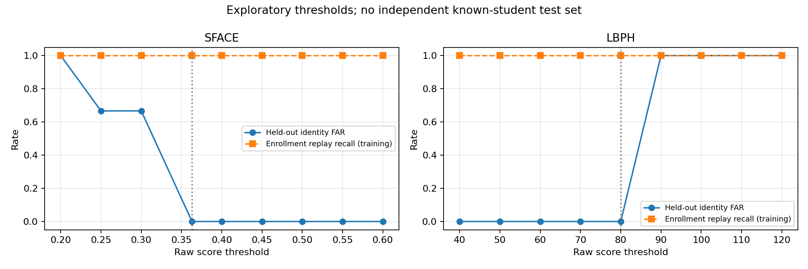

# SG3 executed development report — 26 October 2026

> Historical experiment on the original ten-student dataset. The current default
> classroom gallery has **19 students and 21 accepted templates** from the new
> named dataset; see [CLASS_ENROLLMENT.md](CLASS_ENROLLMENT.md). The old UNKNOWN
> probes overlap the new enrollment data and cannot validate its FAR.

The SG3 prototype runs locally on the development PC. Enrollment, persistent gallery reload, SFace/LBPH recognition, actual SG2 preprocessing, UNKNOWN rejection, a proposed downstream contract, and a sampled CCTV demonstration were executed. **60 automated tests pass.** This is frame-level recognition; SG4 tracking and attendance are not implemented by this work.

## Existing work and changes

The archive already contained functional SFace 128-D embedding/max-cosine matching, LBPH, YuNet largest-face detection, and gallery persistence. These algorithms were retained. SG2 implements quality gates and five-point alignment. SG4 implements an unrelated LFW identification stand-in, without tracking or an SG3 input interface. `integration/` is empty. Historical root-level nine-image scores have no supplied source images and are not reused as current measurements.

New SG3 work adds:

- Private HEIC decoding/preparation, stable pseudonyms, source/pixel hashes, similarity screening and session-aware split manifest.
- An all-faces YuNet adapter that preserves original coordinates and invokes the unchanged SG2 implementation.
- A callable recognition API with separate `RECOGNIZED`, `UNKNOWN`, `QUALITY_REJECTED`, and `ERROR` results; strict shape/type/metadata validation; a proposed SG4 contract and explicitly mock consumer.
- Shared-SG2-crop enrollment/evaluation, gallery provenance and reload verification, descriptive threshold sweeps, extraction/matching timings and synthetic stress diagnostics.
- Local CCTV sampling, annotated AVI, per-frame JSONL, stage timing and saved-output decoding verification.
- Integrity-checked model downloads, gallery validation, empty-directory handling, package imports, requirements and tests. The original legacy scripts remain available.

All **36 original files under SG1, SG2 and SG4 are byte-identical to the ZIP**. Ownership boundaries were preserved. See [the initial assessment](../ASSESSMENT.md) and [run instructions](../README.md).

## Dataset and experimental protocol

The dataset contains 52 HEIC photos: 23 labeled photos across ten students, and 29 unlabeled photos. Labeled counts are 1, 1, 2, 2, 2, 2, 3, 3, 3 and 4. All photos decode at 3024×4032 after orientation. EXIF records one camera and one capture day, 15 October 2026. Original photos are preserved.

There are no exact-byte duplicates. The reproducible bilinear dHash screen finds three candidate groups; five images are conservatively excluded. This is image similarity screening, not proof of duplicate faces. The earlier standalone audit used a different thumbnail resampler and found no candidates; preparation's documented implementation is the authoritative split. Correlated same-session images remain even without hash matches.

| Prepared role | Images | Identities |
|---|---:|---:|
| Enrollment candidates | 16 | 8 |
| UNKNOWN evaluation, whole identities withheld | 5 | 2 |
| Independent known-student evaluation | 0 | 0 |
| Unlabeled retained for inspection | 26 | Unverified |
| Excluded similarity candidates | 5 | Not evaluated |

Unlabeled photos are never treated as confirmed unknown people. No within-session photo split is advertised as independent evaluation. Known-person accuracy, generalization FRR and a production threshold **cannot be estimated from these data**. Enrollment replay is a functional check using training images. UNKNOWN measurements are a tiny held-out-identity diagnostic; they do not establish broad open-set performance.

Both algorithms use exactly the same SG2 accepted 112×112×3 `uint8` BGR crops. The dominant face must have at least 1.5 times the second-largest detection's area, otherwise the sample fails as ambiguous. All original coordinates and SG2 quality data remain attached. SG2's existing baseline configuration is used unchanged.

## Enrollment and measured model comparison

SG2 accepted **4/16 enrollment images**, one each for **four students**. It rejected twelve enrollment images for pose. Four of the eight candidate identities therefore have no usable enrollment template; the gallery does not represent the full class. Of five held-out-identity images, SG2 accepted three and pose-rejected two. Quality rejections were not counted as successful UNKNOWN decisions.

| Actual measurement | SFace, primary baseline | LBPH, comparison |
|---|---:|---:|
| Existing threshold retained | cosine ≥0.363 | distance ≤80 |
| Enrolled identities / accepted templates | 4 / 4 | 4 / 4 |
| Successful enrollment replay | 4/4 scored; 12 quality-rejected | 4/4 scored; 12 quality-rejected |
| UNKNOWN decisions on quality-accepted held-out faces | 3/3 | 3/3 |
| False accepts on those three faces | 0/3 | 0/3 |
| Independent known identification accuracy / FRR | Unavailable | Unavailable |
| Mean recognition API time, seven scored faces | 15.62 ms | 1.81 ms |
| Mean embedding extraction time | 15.41 ms | Not applicable |
| Mean matching time, including LBPH histogram preparation | 0.148 ms | 1.770 ms |
| Recognition API p95 | 16.59 ms | 1.85 ms |
| Gallery fitting time, excludes detection/SG2/save | 100.35 ms | 8.25 ms |
| Saved primary model/gallery artifact size | 2,931 bytes | 542,324 bytes |
| Save/load repeated-match verification | Passed | Passed |

Gallery size excludes the SFace ONNX model (38,696,353 bytes) and metadata/labels. SFace contains one 128-D normalized template per accepted enrollment image; the code and persistence tests support multiple templates per student. LBPH uses its original equalized grayscale texture method. Neither raw cosine nor LBPH distance is a calibrated confidence/probability.

Dataset preparation for the 21 labeled trial images, including image decoding, detection and SG2, took 3.845 seconds. Mean detection was 87.53 ms/photo and SG2 0.635 ms/photo. The full comparison including fitting, inference, and synthetic diagnostics took 6.043 seconds before plot generation: 3.48 labeled inputs/second for this bounded workflow. These figures do not imply live-video throughput.

The selected primary model remains **SFace** because its implemented normalized embeddings fit SG2's alignment contract, support lightweight gallery reuse, and provide a useful raw matching scale. LBPH supplies a faster, working comparison. Both tied on the three scored UNKNOWN trials; this experiment does **not** prove superior identification accuracy for SFace. On one synthetic lower-face occlusion of an enrollment image, SFace returned the training identity at cosine 0.8173, while LBPH returned UNKNOWN at distance 107.18. This is only a diagnostic example. Both rejected synthetic strong blur and darkening through actual SG2 quality gates. Natural profile captures were largely pose-rejected, so no robust profile-recognition claim is supported.

## Threshold experiment

Existing defaults were retained; no threshold was selected by maximizing these test results. All seven scored faces were reused only to describe thresholds, without recomputing embeddings. Replay recall is training behavior and cannot substitute for a held-out FRR estimate.

| SFace threshold | False accepts / 3 scored UNKNOWN faces | Training replay accepted correctly / 4 |
|---:|---:|---:|
| 0.20 | 3/3 | 4/4 |
| 0.25 | 2/3 | 4/4 |
| 0.30 | 2/3 | 4/4 |
| 0.363 | 0/3 | 4/4 |
| 0.40–0.60 | 0/3 at each tested point | 4/4 |

The three SFace UNKNOWN similarities were 0.3518, 0.3069 and 0.2398; the first is close to the default threshold. LBPH rejected all three at thresholds 40–80 but falsely accepted all three at 90–120. Three trials from two identities cannot establish a reliable FAR, particularly as the images are correlated. Collect independent known and unknown capture sessions and a separate calibration set before threshold tuning.

Full aggregate values are in [metrics.json](metrics.json). Private per-face scores and source mappings remain in ignored local run directories.

## Actual CCTV demonstration

The supplied HEVC video is 2560×1440 at 25 fps, with 104,935 frames and a duration of 4,197.4 seconds (69m57.4s). Decode checks succeeded at 0, 600, 1800 and 3600 seconds. The fixed elevated diagonal view includes small/distant, sideways, head-down and occluded faces, with stable indoor lighting. In populated sections approximately 30–35 seated people are visible; detector counts are observations and do not establish person recall.

The executed run sampled **600, 900, 1200, 1500, 1800 and 2100 seconds**, with YuNet inference limited to a 1280-pixel maximum side. SG2 still measured boxes in the original frame. This is a clearly labeled temporary SG3 detector, not completed SG1 integration.

| Result across six frames | Count |
|---|---:|
| Face detections, repeated across frames | 215 |
| SG2 accepted / quality-rejected | 18 / 197 |
| Recognition decisions: pseudonym / UNKNOWN | 1 / 17 |
| Recognition errors | 0 |
| Rejected for size / pose / illumination | 165 / 31 / 1 |

The one pseudonymous match is unverified because CCTV identity ground truth is absent. Its cosine 0.3703 is only 0.0073 above the provisional 0.363 threshold. **It must not be described as a correct identification, unique tracked student, or attendance record.** Accepted quality is not a guarantee of identity correctness. Most visible detections fail the minimum face-size gate; distant seats need improved capture conditions, detector resolution, or a separately validated preprocessing policy. Gates were not weakened to inflate recognition counts.

| Mean stage latency per sampled frame | Time |
|---|---:|
| Seek/decode | 270.74 ms |
| Detection | 76.34 ms |
| SG2 quality/alignment | 2.26 ms |
| Recognition, all decisions in frame | 48.87 ms |
| Annotation | 12.62 ms |
| Video writing | 52.64 ms |
| Total sampled frame | 463.83 ms |

The six-frame processing loop took 2.786 seconds (2.15 sampled frames per wall second, including seeking/output). Mean recognition on 18 SG2-accepted CCTV faces was 15.92 ms/face. The annotated AVI contains exactly six decodable frames at 2 fps, a **three-second time-compressed preview**. Saved JSONL has exactly six records with original frame IDs/timestamps and original-frame boxes. There is no continuous tracking and no attendance file.

Each of the six saved source timestamps was independently checked against OpenCV's decoded presentation timestamp, with zero discrepancy. The runner assumes constant frame rate; generic variable-frame-rate input remains unverified.

Private outputs: `module_sg3/private_runs/video/annotated_samples.avi`, `frame_results.jsonl`, `summary.json`. Aggregate CCTV observations are also in [video_summary.json](video_summary.json).

## Verification and environment

Executed on Windows 11 build 26200, Python 3.12.14, AMD64 Family 25 Model 80, with 12 OpenCV threads. Packages: opencv-contrib-python 4.11.0.86, NumPy 2.5.4, Pillow 13.0.0, pillow-heif 1.1.1, matplotlib 3.10.8, pytest 8.4.2. The exact resolved Windows dependency snapshot is [requirements-lock-windows.txt](../requirements-lock-windows.txt); it is not an ARM/Ubuntu lock file.

The 60 tests cover actual SG2 quality/alignment, API/schema errors and rejections, coordinates/timestamps, gallery validation/multiple templates/reload, integrity-check failure/atomic model replacement, session/duplicate splitting, undefined metric denominators, and real synthetic-video encode/decode. Test data are synthetic; these tests verify mechanics, not face-recognition accuracy. SG2's separate self-check also passed 12/12.

Both public models were downloaded from OpenCV Zoo and verified against upstream Git LFS SHA-256 object IDs; weights and biometric data remain excluded from Git. See [the model manifest](../models_manifest.json), [OpenCV's SFace documentation](https://github.com/opencv/opencv_zoo/tree/main/models/face_recognition_sface), and [the OpenCV recognition tutorial](https://docs.opencv.org/4.x/d0/dd4/tutorial_dnn_face.html). Its 0.363 LFW reference threshold is not a classroom validation result.

## Integration blockers and midterm evidence

| Owner / criterion | Current evidence and remaining work |
|---|---|
| SG3 working prototype | Actual local enrollment/reload, recognized enrollment replay, withheld UNKNOWN rejection, CCTV AVI/JSONL, genuine metrics. Four usable enrolled identities; full roster enrollment remains blocked by source quality/pose coverage. |
| Algorithm choice/comparison | SFace and LBPH share crops/split; actual timing, descriptive thresholds, stress diagnostic. Independent identification accuracy is unavailable. |
| V1/reproducibility | Callable API, typed conventions, example packets, mock contract tests, model checksums, source/config provenance and commands. Downstream agreement still needed. |
| SG1/SG2 | SG1 must supply five landmarks/full-frame boxes. SG2 baseline is invoked unchanged; rejection coverage is reported. Investigate pose coverage and small faces with SG2 owners using independent data. |
| SG4 | Agree the proposed result contract and implement temporal association/evidence aggregation. Detection IDs are per-frame. Existing 512-D SG4 gallery cannot consume SFace's 128-D vectors; use SG3 identity evidence. Mock validation is not full integration. |
| SG5 | Attendance decisions remain outside SG3. No attendance record is generated. |
| SG6 / Jetson / camera | No actual Jetson Orin Nano or camera was available. Test OpenCV contrib/ONNX/video support, models/gallery reuse, memory, end-to-end latency and sustained thermal behavior on the device. No CUDA/TensorRT or Jetson benchmark is claimed. |
| Shared GitHub/project management | ZIP has no `.git`, remote or history. Source/tests/reports are ready for team review; no commit, PR, project-board or shared GitHub evidence was fabricated. |

The next useful data collection is a new capture session containing frontal and varied-angle images of enrolled students plus consented, truly withheld identities. Keep original data, templates, mappings and CCTV private. Only source, tests and reviewed aggregate reports belong in the shared repository.
